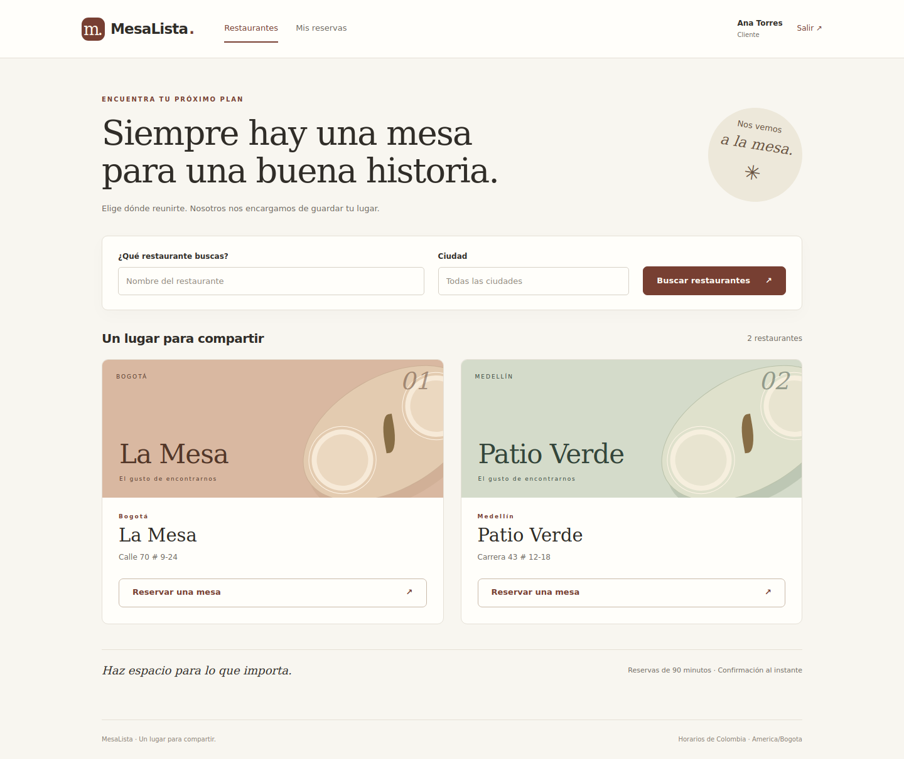

# MesaLista · Reservas de restaurantes

Aplicación web funcional en **Python + Flask + SQLite** para clientes y administradores. Implementa el análisis y diseño del parcial mediante tres capas, DAO y cuatro patrones de diseño explícitos.



## Qué permite hacer

- Iniciar y cerrar sesión con el rol de la cuenta.
- Buscar restaurantes por nombre y ciudad y consultar horarios disponibles.
- Reservar una mesa adecuada al grupo, con confirmación inmediata.
- Consultar el detalle, cancelar una reserva futura y preparar una nueva a partir de una anterior.
- Administrar mesas y franjas de atención de los restaurantes asignados.
- Crear reservas para clientes existentes desde el rol administrador.
- Conservar el historial y evitar reservas simultáneas incompatibles.

**Alcance académico:** las cuentas y los restaurantes se cargan con datos iniciales. No incluye registro público, pagos, pedidos, recuperación de contraseña, notificaciones ni combinación de mesas.

## Ejecutar en Debian 13

No necesitas Java, Eclipse, Node ni un servidor de bases de datos. Puedes editar los archivos con Sublime Text. Necesitas Python **3.12 o 3.13**; la entrega se verificó con ambos.

Instala las herramientas del sistema una sola vez:

```bash
sudo apt update
sudo apt install python3 python3-venv python3-pip git
```

Abre la terminal dentro de la carpeta que contiene este README:

```bash
python3 -m venv .venv
source .venv/bin/activate
python -m pip install -r requirements-dev.txt
python scripts/configurar.py
flask --app run.py init-db
flask --app run.py seed-demo
python run.py
```

Abre **http://127.0.0.1:5000**. Para detener el servidor, pulsa `Ctrl+C`.

`configurar.py` genera `.env` con una clave de sesión aleatoria y una contraseña local de demostración. **Abre `.env` en Sublime y copia el valor de `DEMO_PASSWORD`**, sin el nombre de la variable, para iniciar sesión. El archivo no se incluye en GitHub. Si ya existe, el script lo conserva.

| Cuenta | Rol | Acceso |
| --- | --- | --- |
| `cliente@demo.local` | Cliente | Sus propias reservas |
| `cliente2@demo.local` | Cliente | Sus propias reservas |
| `admin@demo.local` | Administrador | La Mesa, Bogotá |
| `admin2@demo.local` | Administrador | Patio Verde, Medellín |

Las cuatro cuentas iniciales usan la contraseña local de `DEMO_PASSWORD`. Las personas y direcciones de demostración son ficticias. La base almacena hashes con sal, no contraseñas originales.

`seed-demo` exige una base sin usuarios y nunca sobrescribe cuentas. Crea dos restaurantes, 14 mesas y dos franjas diarias por restaurante: **11:30–15:30** y **18:00–22:30**. El historial comienza vacío; crea una reserva para recorrer el caso de uso.

En las siguientes ejecuciones basta con:

```bash
source .venv/bin/activate
python run.py
```

Para ejecutar sin herramientas de desarrollo, instala `requirements.txt`. Para pruebas y revisión de formato utiliza `requirements-dev.txt`, que incluye el anterior. SQLite forma parte de Python.

## Recorrido de demostración

1. Entra como cliente, abre **La Mesa** y selecciona una fecha futura.
2. Elige el número de personas, pulsa **Consultar horarios**, selecciona una hora y confirma.
3. Revisa identificador, mesa, intervalo y estado en el detalle.
4. Pulsa **Volver a reservar**: se copian los datos editables y se pide una confirmación nueva.
5. Cancela la reserva original antes del inicio. Su registro queda en el historial.
6. Entra como `admin@demo.local`, crea una reserva para el segundo cliente y revisa **Administración**.
7. Intenta desactivar una mesa con una reserva futura: el sistema rechaza el cambio.
8. Comprueba que ese administrador no puede gestionar el restaurante del segundo administrador.

## Arquitectura y patrones

| Capa o paquete | Responsabilidad |
| --- | --- |
| `reservas/presentacion/` | Controladores Flask, formularios, plantillas Jinja y recursos locales |
| `reservas/aplicacion/` | Casos de uso, permisos, disponibilidad, fachada y contratos DAO/UoW |
| `reservas/dominio/` | Entidades, invariantes y errores; no depende de Flask ni SQLite |
| `reservas/patrones/` | Builder, Prototype y adaptador de sesión |
| `reservas/infraestructura/` | DAO SQLite, unidad de trabajo, esquema y carga inicial |
| `tests/` | Casos P01–P30 e integración HTTP y de integridad |
| `docs/` | Diseño, diagramas, evidencias y guion de sustentación |
| `site/` | Presentación estática opcional para GitHub Pages |

MVC organiza la presentación; los servicios ejecutan los casos de uso y la infraestructura implementa los contratos de persistencia. `create_app` es el punto de composición: **no se cuenta como Factory Method**.

| Patrón | Tipo | Participantes y uso real |
| --- | --- | --- |
| Builder | Creacional | `ConstructorReserva`, `ReservaBuilder`, `DirectorReserva`, `ContextoReserva`, `Reserva`; se usa en `ServicioReserva.crear` |
| Prototype | Creacional | `Prototipo`, `DatosReserva.clonar`; se usa al repetir una reserva sin copiar identidad ni estado |
| Facade | Estructural | `ReservaFacade`; coordina acceso, disponibilidad y operaciones para ambos roles |
| Adapter | Estructural | `UsuarioSesionAdapter`; adapta `Usuario` al contrato de Flask-Login |

Los decoradores de rutas o de autenticación no se cuentan como patrón Decorator. Cada patrón tiene pruebas y diagramas asociados. Consulta [el resumen para el equipo](resumen.md) y [los diagramas editables](docs/diagramas.md).

## Reglas e integridad

- Una reserva ocupa una sola mesa; se selecciona la menor capacidad suficiente y se desempata por ID.
- Duración inicial de **90 minutos**, configurable para reservas nuevas mediante `RESERVA_DURACION_MINUTOS`. Los intervalos guardados no se recalculan.
- Horarios en **America/Bogota**; fechas persistidas en UTC con formato uniforme.
- Inicios futuros en pasos de 30 minutos desde la apertura; todo el intervalo debe caber en una franja.
- La consulta de cupos es provisional. La creación revalida permisos y disponibilidad después de `BEGIN IMMEDIATE`.
- Una unidad de trabajo abre una conexión por operación; todos sus DAO comparten esa conexión. Los DAO no hacen `commit`.
- Dos intervalos se superponen si `nuevo_inicio < fin_existente` y `nuevo_fin > inicio_existente`. Se permiten reservas contiguas.
- Claves foráneas, restricciones e índices están en [schema.sql](reservas/infraestructura/schema.sql). Dos triggers refuerzan la prohibición de solapamientos.
- El token de operación hace idempotente un reenvío del mismo actor y contenido. Es distinto del token CSRF.
- Se conserva el token ante un error recuperable de bloqueo. La espera de SQLite es de cinco segundos.
- Se impiden cambios de mesa u horario que invaliden reservas confirmadas aún no terminadas.
- Los únicos estados persistidos son `CONFIRMADA` y `CANCELADA`. “En curso” y “Finalizada” son etiquetas calculadas para la vista.

## Pruebas

```bash
source .venv/bin/activate
python -m pytest -q
ruff check .
ruff format --check .
python -m pip check
```

La entrega incluye **61 pruebas ejecutadas correctamente** en Python 3.12 y 3.13. Los 30 casos del diseño se identifican por `P01`–`P30`; algunos tienen varias variantes. La prueba `P17` utiliza **dos conexiones independientes y una barrera de sincronización** sobre una base temporal compartida. No simula concurrencia con inserciones secuenciales.

Las pruebas crean sus propias bases temporales y no tocan `instance/reservas.sqlite3`. El reloj del negocio se inyecta, así que los resultados no dependen de la fecha del computador. Las rutas HTTP se prueban con CSRF activo.

[Resultados y trazabilidad](docs/pruebas.md) · [Capturas reales y recorrido](docs/evidencias.md)

El workflow `.github/workflows/tests.yml` ejecuta las pruebas en cada `push` a `main`, en los pull requests y manualmente. Estará activo después de subir el código a un repositorio con GitHub Actions habilitado.

## GitHub y despliegue

**GitHub almacena el código, pero GitHub Pages no ejecuta Python ni un servidor Flask.** Publicar las plantillas en Pages no implementaría login ni persistencia de reservas. Por eso se incluyen dos destinos claramente separados:

| Destino | Contenido |
| --- | --- |
| Repositorio GitHub | Código, README, diagramas, pruebas y evidencias |
| Servidor Python con disco persistente | Aplicación completa Flask + SQLite |
| GitHub Pages, opcional | Presentación de `site/`, con enlace al servidor real |

La configuración está preparada; **esta entrega no crea un repositorio ni publica un servicio externo**.

### Subir a GitHub

Crea un repositorio vacío llamado, por ejemplo, `mesalista-reservas`. Desde la carpeta del proyecto:

```bash
git init -b main
git add .
git status
git commit -m "Implementar sistema de reservas con Flask y patrones de diseño"
git remote add origin https://github.com/TU_USUARIO/mesalista-reservas.git
git push -u origin main
```

Sustituye `TU_USUARIO` por tu cuenta y utiliza el método de autenticación configurado en tu equipo. `.gitignore` excluye `.env`, entornos virtuales y bases de datos. Antes del primer commit, comprueba que esos archivos no aparecen en `git status`.

### Publicar la aplicación completa

Consulta [la guía de despliegue](docs/despliegue.md). Incluye ejecución con Gunicorn, respaldo de SQLite y una configuración opcional para **Render con disco persistente** en `deploy/render.yaml`.

**El disco persistente de Render requiere un servicio de pago.** No se presenta el plan gratuito con disco efímero como una solución que preserve reservas. La alternativa es un servidor Linux propio o de la universidad con almacenamiento persistente.

### Publicar la presentación en GitHub Pages

1. Si ya tienes la aplicación desplegada, escribe su URL HTTPS en `site/config.js` y sube el cambio.
2. En el repositorio abre **Settings → Pages → Source → GitHub Actions**.
3. En **Actions**, ejecuta manualmente **Publicar presentacion en Pages** sobre la rama `main`.
4. GitHub mostrará la URL publicada. El workflow solo envía `site/`.

Si la URL de Flask está vacía, la página explica que el servidor aún no está configurado. No muestra un login ficticio ni guarda reservas en el navegador.

## Configuración, mantenimiento y problemas frecuentes

| Variable | Uso |
| --- | --- |
| `SECRET_KEY` | Secreto de sesión, mínimo 32 caracteres; distinto para cada entorno |
| `DATABASE_PATH` | Ruta del archivo SQLite; predeterminado `instance/reservas.sqlite3` |
| `DEMO_PASSWORD` | Solo carga inicial de las cuentas ficticias; no cambia contraseñas ya cargadas |
| `COOKIE_SECURE` | `0` para localhost HTTP; `1` cuando el servidor se expone mediante HTTPS |
| `RESERVA_DURACION_MINUTOS` | Duración de nuevas reservas; predeterminado `90` |

**Respaldo:** `python scripts/respaldo.py instance/respaldo.sqlite3`. El destino debe ser nuevo. Usa la API de backup de SQLite para obtener una copia consistente. Conserva los respaldos fuera del repositorio.

**Error “externally-managed-environment”:** activa `.venv` y usa `python -m pip`, sin `sudo pip`.

**No se puede abrir la base:** ejecuta `flask --app run.py init-db` y revisa `DATABASE_PATH` y los permisos de la carpeta.

**No puedo entrar:** revisa el correo y el valor de `DEMO_PASSWORD` usado al cargar la base. Editar `.env` después no cambia el hash de las cuentas existentes.

**El formulario venció:** vuelve a abrir la página y envía un formulario nuevo.

**Cookies en localhost:** usa `COOKIE_SECURE=0`; en un servidor HTTPS usa `1`. Después de cambiar `.env`, reinicia el proceso.

**Puerto ocupado:** ejecuta `flask --app run.py run --port 5001` y abre `http://127.0.0.1:5001`.

No actives el depurador en Internet. Para el servidor usa Gunicorn. Este módulo se diseñó para la demostración académica y una sola instancia con SQLite; una explotación comercial requeriría ampliar el alcance operativo (recuperación de cuentas, políticas de acceso, monitoreo, límites de intentos y copias externas).

## Documentación del equipo

- [Diseño aprobado en Google Docs](https://docs.google.com/document/d/14z_A_z1YTG5Pj5Uts0hP8RasWQNbZ8ZtvMGVArdb-Fk/edit).
- [Resumen de clases y patrones](resumen.md).
- [Diagramas Mermaid: arquitectura, dominio, relacional, DAO, patrones y secuencia](docs/diagramas.md).
- [Trazabilidad y pruebas](docs/pruebas.md).
- [Capturas y guion del video](docs/evidencias.md).
- [Decisiones de implementación](docs/decisiones.md).

Las capturas del ZIP corresponden a ejecuciones reales con datos ficticios. El equipo debe grabar y publicar el video y añadir su enlace a la entrega; no se inventa un enlace de YouTube.

## Referencias técnicas

- [Flask](https://flask.palletsprojects.com/en/stable/).
- [Flask-Login](https://flask-login.readthedocs.io/en/latest/).
- [CSRF en Flask-WTF](https://flask-wtf.readthedocs.io/en/latest/csrf/).
- [SQLite: aislamiento](https://sqlite.org/isolation.html).
- [GitHub Pages: creación de un sitio y limitaciones](https://docs.github.com/en/pages/getting-started-with-github-pages/creating-a-github-pages-site).
- [Render: Flask](https://render.com/docs/deploy-flask) y [discos persistentes](https://render.com/docs/disks).
