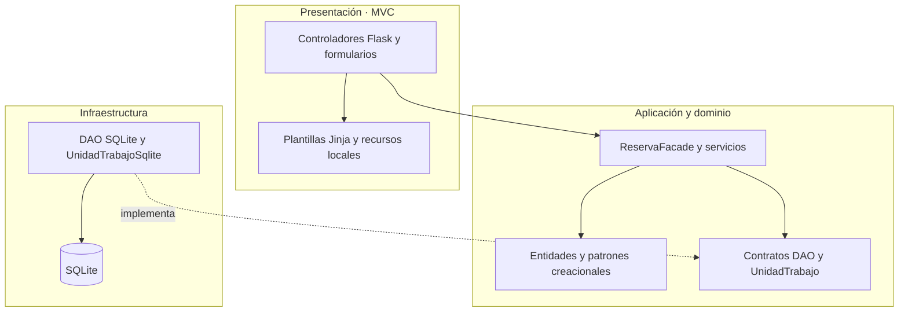
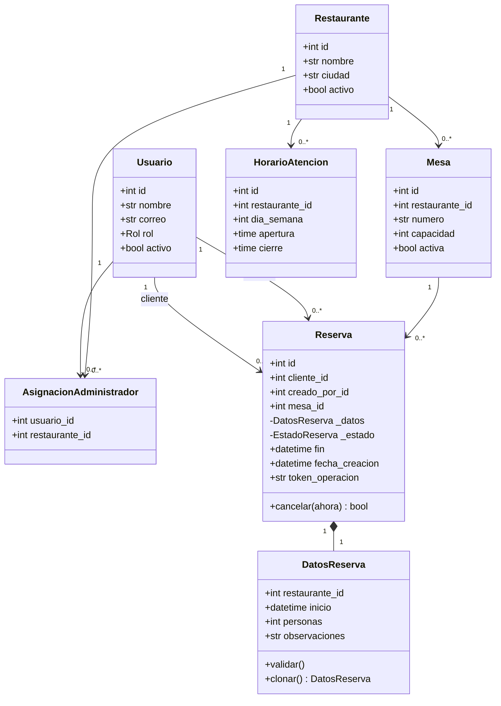
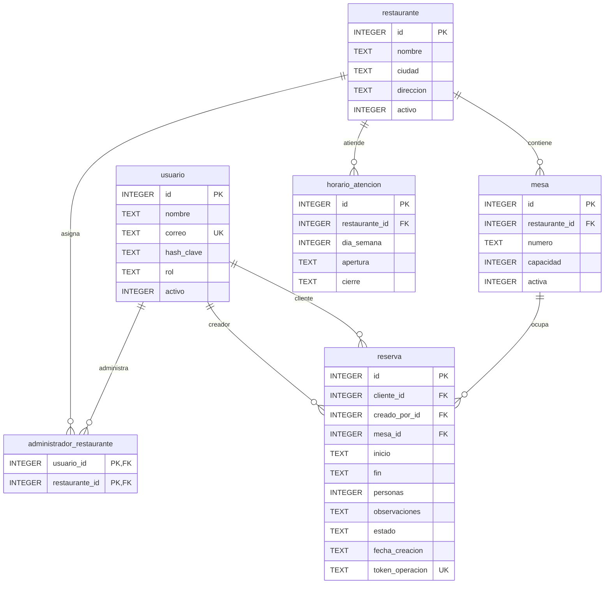
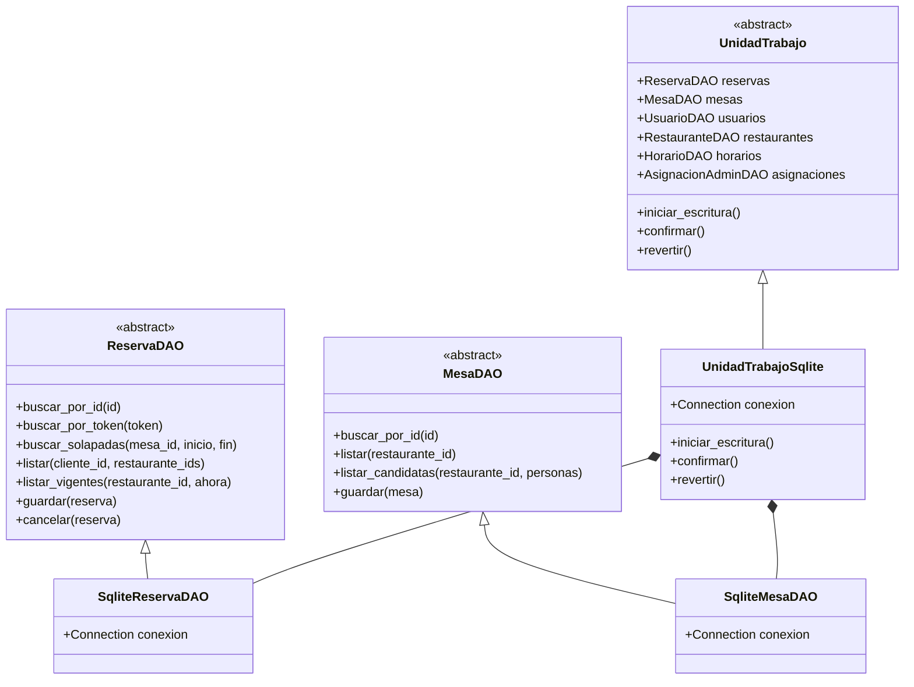
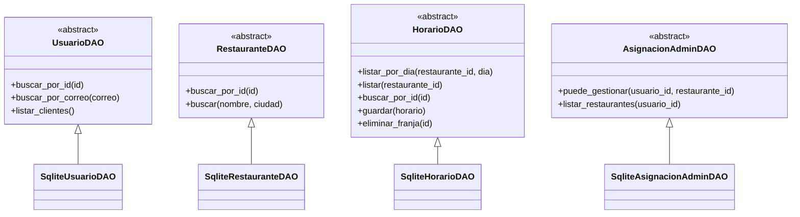
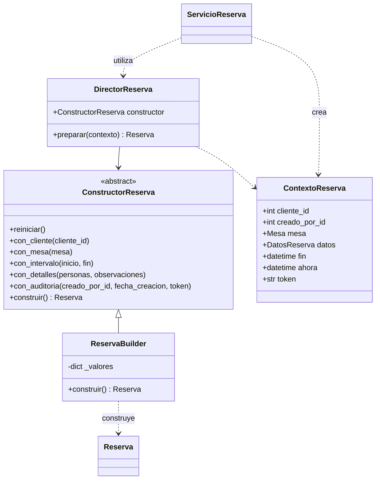
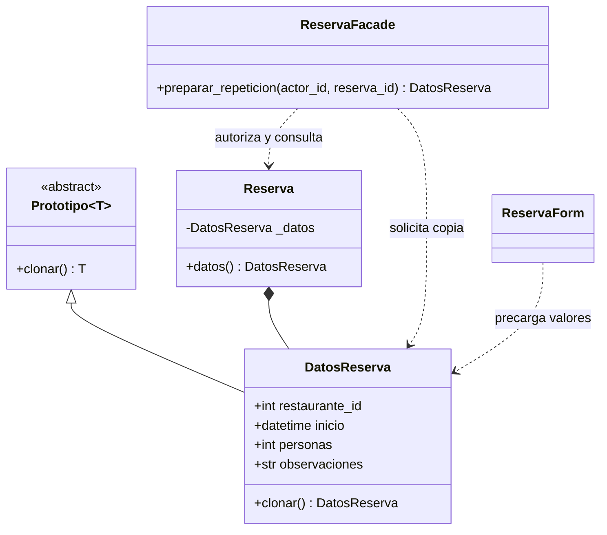
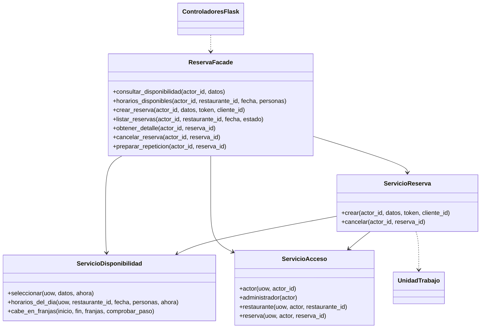
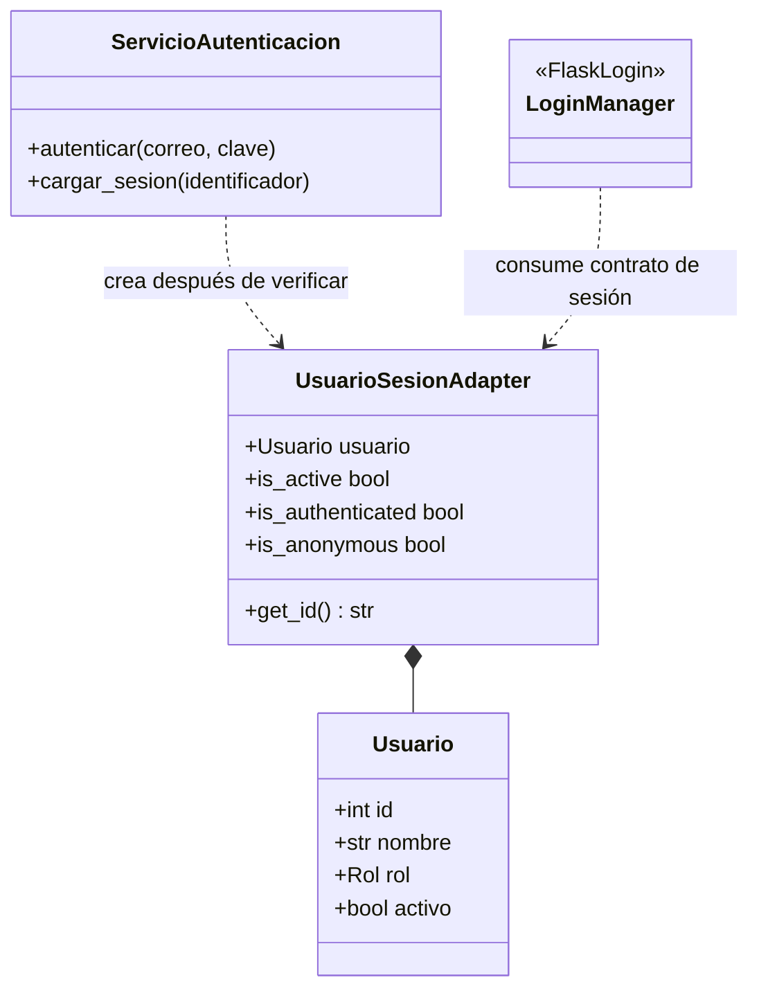
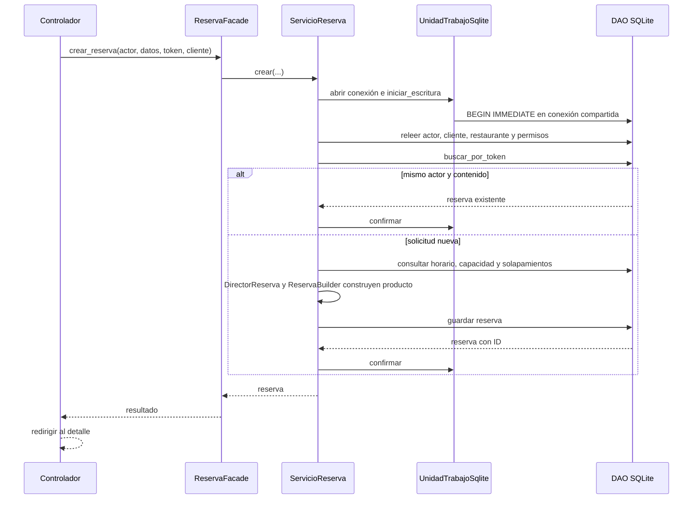

# Diagramas de la implementación

Los nombres corresponden a las clases del código entregado. GitHub renderiza los bloques Mermaid. Cada bloque también está disponible como `.mmd` en `docs/diagramas/` para editarlo o importarlo en una herramienta compatible. Se incluyen también versiones SVG y PNG renderizadas y verificadas de los diez diagramas.

## 1. Arquitectura en tres capas

`create_app` conecta los contratos con SQLite mediante una función que construye una unidad de trabajo nueva. El dominio no importa Flask. La interfaz depende de los casos de uso, no de SQL.

## 2. Clases del dominio

Las asociaciones se representan mediante identificadores al persistir. `Reserva.datos` expone una copia para proteger su composición; `cancelar` controla la transición a CANCELADA.

## 3. Modelo relacional

Además de lo indicado, `UNIQUE(restaurante_id, numero)` protege el número de mesa. `schema.sql` contiene los CHECK, índices y triggers. `DatosReserva` se reconstruye mediante un JOIN con mesa; no existe una tabla adicional ni un restaurante duplicado en reserva.

## 4. DAO de reservas, mesas y unidad de trabajo

La unidad de trabajo implementa un administrador de contexto (`__enter__`, `__exit__`). Crea sus DAO y les entrega una sola conexión. Desactivar una mesa se expresa mediante `guardar` con `activa=False`, sin borrar la fila.

## 5. DAO de catálogos y autorización

Todos los DAO SQLite reciben la conexión de `UnidadTrabajoSqlite`; no abren conexiones secundarias ni confirman transacciones. Las clases de servicios establecen los permisos.

## 6. Builder

`ServicioReserva` valida permisos y disponibilidad antes de construir. El director depende del contrato. El builder valida completitud e invariantes y entrega una reserva sin ID; SQLite asigna su identidad al guardar.

## 7. Prototype

`datos` es una propiedad de Python, representada aquí como acceso de lectura. La copia tiene identidad propia como objeto; no contiene ID ni estado de la reserva anterior. Actualmente todos sus atributos son inmutables: basta construir otro contenedor mediante `dataclasses.replace`.

## 8. Facade y servicios

La fachada conserva la autorización de lectura y delega la creación y cancelación al servicio transaccional. Los servicios de catálogos y configuración tienen casos de uso separados para mantener acotada la fachada.

## 9. Adapter de sesión

`LoginManager` es una clase real de Flask-Login. El contrato esperado por la biblioteca se cumple por los miembros del adaptador; no se inventa una interfaz abstracta externa.

## 10. Secuencia de creación de reserva

BEGIN, INSERT y COMMIT operan sobre la conexión de la unidad de trabajo. Si falla cualquier paso, su salida revierte y cierra. En el diagrama, la columna DAO representa el acceso SQLite compartido; el dueño de la transacción es UoW, no un DAO. La disponibilidad consultada antes de este flujo no reserva la mesa.
